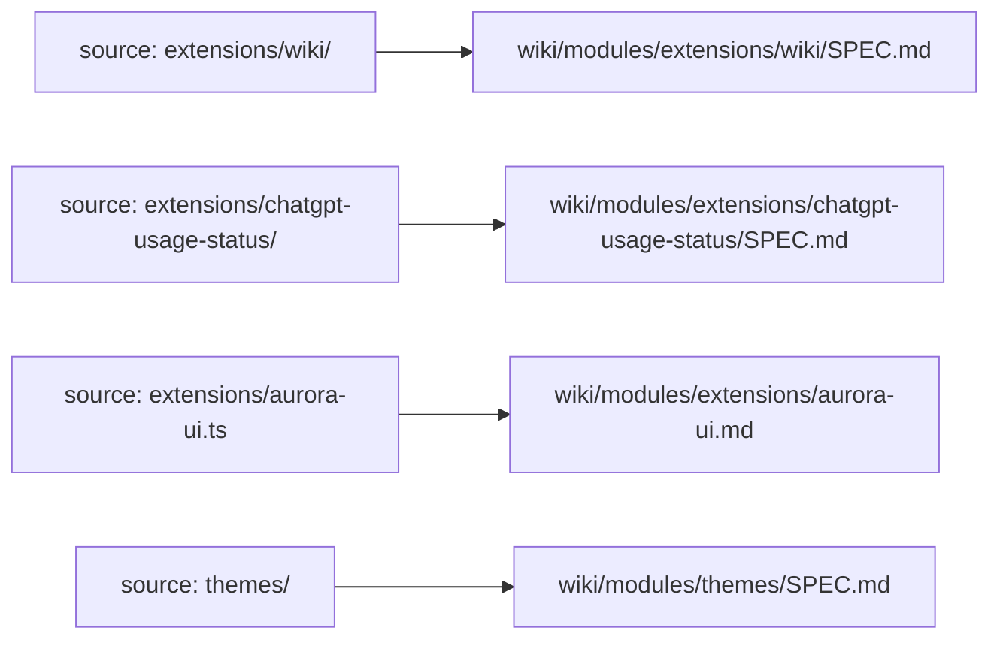
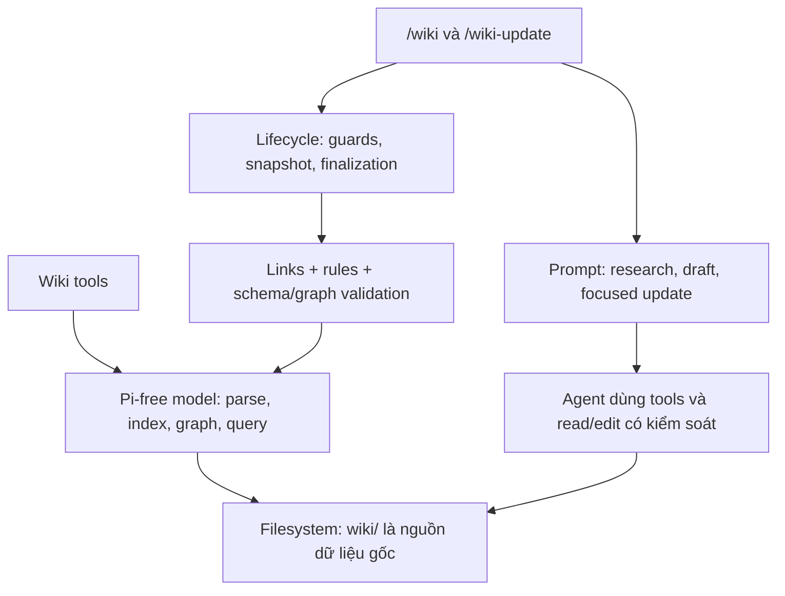

# Kế hoạch nâng cấp Wiki thành hệ tri thức dựa trên Spec Graph

> **Trạng thái: đã có read model, sáu read tools (gồm source/policy routing), section retrieval, hai metadata tools, generator prompt cho Wiki mới và graph checks trong no-op/finalization. Migration Wiki cũ đã bỏ khỏi scope theo yêu cầu.**
>
> Đây là implementation brief, không phải spec đang có hiệu lực và không phải tài liệu mô tả tính năng đã phát hành. Các tên tools, schema mở rộng, đường dẫn mẫu và cách chia module bên dưới là thiết kế đề xuất, trừ những mục được ghi rõ là đã thống nhất. Chỉ phần tiến độ dưới đây và canonical Wiki/source/tests xác nhận những gì đã triển khai; các phần còn lại không tự chứng minh runtime đã có đủ graph workflow.
>
> Tài liệu chi tiết vì phục vụ thiết kế/migration. Nó không phải mẫu độ dài cho các specs mà generator sẽ tạo.

## Tiến độ triển khai thực tế

- **Đã làm:** vendor pi-free core và tests ThinkRail tại commit T1–T16, kèm license/provenance; thêm read model nội bộ `packages/pi-learn-extensions/extensions/wiki/wiki-model.ts`. Patch store hooks/barrel để giữ exclusions, guides, I/O diagnostics và content revalidation; parser chỉ đổi log level để không emit YAML warning chứa source excerpt, vẫn giữ parse-error semantics. Graph/query/structural validator và tests gốc giữ nguyên upstream.
- **Adapter đã có:** Wiki-only index, metadata lookup, filtered search, bounded graph slices, schema/graph diagnostics; không chọn canonical owner khi ID trùng. Giới hạn đọc 1 MiB/file, kiểm UTF-8/NUL, không theo symlinks; không gọi đây là OS sandbox. Schema read-tolerant giữ unknown types/missing title/legacy scalar lists dưới warning; malformed identities/lists là error. Đây là read policy; metadata tools có authoring validation nghiêm hơn ở writer riêng.
- **Read tools đã wire:** `wiki_search`, `wiki_get`, `wiki_locate`, `wiki_rules`, `wiki_graph`, `wiki_validate` trong `wiki-tools.ts`, chỉ qua entrypoint Wiki hiện có. Search mặc định all (specs + legacy guides); get metadata/headings mặc định theo đúng một ID/path, explicit heading trả verbatim section có continuation; graph dùng count/depth caps; validate mặc định graph, có links/rules/all rõ scope. Rules chỉ được lint qua đường đọc riêng, không trả policy text hoặc tạo scaffold. Tổng content + details tối đa 24 KiB/lượt; output lớn dùng JSON fragments có revision/continuation, không ghi full output ra temp file. Chi tiết contract ở [Wiki read tools](../wiki/extensions/wiki-extension.md#read-only-wiki-tools).
- **Workflow integration đã có:** update prompt hướng dẫn selective tools + fallback khi unavailable; init tập trung research/write/safety/validation, không nhúng lookup/tool manuals hoặc lời kể runtime, không auto-migrate guides; update giữ tri thức lâu dài từ task, stable IDs/reverse consumers và không tự promote review status. Graph/schema validation chạy trước no-op và trong settled finalization, lỗi không được skip/complete dù Wiki không đổi; warnings không chặn complete. Event settled aborted được tôn trọng. Metadata schema/snapshot prefix, rules/scaffold permissions và top-level bootstrap chưa đổi.
- **Authoring đã có:** `wiki_spec_create` tạo draft scaffold mới, `wiki_spec_update` sửa frontmatter-only qua core ThinkRail, expectedRevision từ wiki_get.data.revision, strict authoring và proposed graph validation. Chỉ active Wiki run cùng instance/cwd, recheck permit sau queue; quyền built-in normal-page edit/write không đổi. Run state đã chuyển từ module-global sang extension-instance. Repo/file queues chống duplicate-ID và lost updates trong Pi; external editor races/I/O partial failures không phải transaction/sandbox.
- **Generator prompt đã nâng:** khảo sát agent files → docs → manifests/layout → code/tests/operations; trước khi viết dựng working model trong context (purpose, domain, stack, modules, invariants, decisions/missing why), không tạo file mới. Specs theo genuine boundaries cho repo mới/vùng thật sự chưa có tài liệu, stable IDs/meaningful relations, responsibility/boundary/contracts/rationale, draft/evidence labels. Guides/operations vẫn riêng; không convert/split/move/delete hoặc nhân bản canonical contracts cũ. Chưa benchmark bằng model thật.
- **Prompt cleanup đã làm:** bỏ Spec authoring mechanics khỏi cả hai modes, bỏ Wiki lookup khỏi init, gộp evidence/canonical-owner/draft/safety instructions, bỏ điều kiện “For NEW Wikis…” và câu cấm copy package names gây hiểu nhầm. Plan mặc định trong context; chỉ tạo file tạm khi cần và chưa có, chỉ xóa plan do run tạo. Brief trống/vắng không có đoạn placeholder. Bootstrap helper/setup riêng vẫn giữ nguyên template và ownership; chưa chuyển sang deterministic writer. Tại thời điểm cleanup trước các bổ sung research/routing, init giảm khoảng 45% ký tự so với bản trước cleanup (cùng cwd placeholder, không brief/note); đây là số đo lịch sử, không phải chất lượng generation hoặc kích thước bản mới nhất.
- **Routing/section đã có:** `wiki_get` dùng exact ATX heading title/`#anchor`, duplicate titles cần occurrence, share fence-aware heading resolver với links. `source-paths` là unique literal file/trailing-/ directory scopes, không globs; `wiki_locate` trả mọi declared owners (cap 200), xếp specificity không chọn winner/đọc source/theo rename. Writer reuse upstream cho metadata chung và YAML-AST adapter nhỏ cho source list. `wiki_rules` đọc opt-in `wiki/_domains.json`, AND path/task selectors trong domain và union domains + root/existing ancestors; trả paths, không policy text. Config hợp lệ chọn discovery/lint/scaffold theo domains; config lỗi không fallback và chặn complete/no-op, nhưng update vẫn repair được. Không config giữ legacy behavior. Config tham gia snapshot và cùng protection class với rules; không tự tạo config hoặc migrate rules cũ. [Schema/cách dùng](../wiki/extensions/wiki-extension.md#source-scope-và-policy-domains).
- **Đã kiểm:** 148 Node Wiki tests, 8 Aurora tests, 6 theme tests; 55 upstream core tests pass bằng Bun, 2 conditional skips Windows/case-folding. Read model/tools qua focused strict TypeScript check. Có smoke riêng trên Pi v1.5.0 loader/TypeBox thật với fixture headless, command handler/finalization qua transport giả lập và factory replacement, không gọi provider hoặc đọc user auth/settings; không coi đó là kiểm TUI `/reload` thật. Artifact read-tools đã pack/install vào thư mục tạm và pass cùng host smoke; `yaml` được cài theo dependencies, Pi/TypeBox do host cung cấp, không cài bản sao runtime peers.
- **Còn lại:** general workflow routing/skills và subagent integration; manual TUI/semantic generator evaluation. Delete/rename tools chưa có. Migration Wiki cũ bị loại khỏi scope, không phải việc phải làm tiếp; legacy guides giữ nguyên và không tự thành nodes.
- **Rules maintenance riêng:** reconcile mâu thuẫn rules ở phần 3.2 qua quy trình được phép; lượt này không sửa rules hoặc thay quyền. Chi tiết reuse/patches nằm trong `packages/pi-learn-extensions/extensions/wiki/vendor/thinkrail-spec-graph/README.md`.

Các phần thiết kế bên dưới vẫn là đích đề xuất trừ những phần đã ghi rõ triển khai ở đây. Tools/generator prompt có hiệu lực sau reload đúng package mới. Các phần mô tả migration/adoption trước đây đã bị supersede bởi quyết định không migration ở phần 1.1; không thực hiện chúng khi tiếp tục plan này.

## 1. Quyết định hướng đi

Nâng cấp **extension Wiki của Pi Learn**, dùng được cho các repository người dùng mở, không hard-code riêng cấu trúc Pi Learn:

- Giữ toàn bộ tài liệu được sinh trong `wiki/`.
- Chuyển lớp kiến thức về code từ Wiki thiên về mô tả implementation sang **specs theo module, có ID và quan hệ truy vấn được**.
- Giữ hai commands `/wiki` và `/wiki-update` cùng các cơ chế điều phối, bảo vệ và finalization cần thiết.
- Không xóa extension hiện tại để chỉ cài nguyên package `pi-spec-graph` của ThinkRail. Package đó không thay thế toàn bộ workflow sinh/bảo trì Wiki.
- Không duy trì hai bộ Wiki và specs cùng sở hữu một contract. Specs là lớp kiến thức chính; guides và operations chỉ giữ phần có mục đích riêng.
- Chưa triển khai code, migrate tài liệu, thay rules hoặc thay bootstrap trong lượt tạo tài liệu kế hoạch này.

### 1.1 Đã thống nhất trong trao đổi

1. Ưu tiên coding agent hiểu repo và sửa code đúng; tài liệu cho người đọc vẫn phải dễ sử dụng.
2. Giữ tài liệu tập trung trong `wiki/`, không rải `SPEC.md` cạnh source.
3. Tổ chức đặc tả tương ứng với **module/boundary thực**, không tạo một spec cho mọi folder/file.
4. Specs cô đọng, ưu tiên responsibility, boundary, contract, quyết định và các bẫy không hiển nhiên.
5. Không rút ngắn máy móc hoặc xóa cơ chế/lifecycle quan trọng chỉ vì chúng dài.
6. Agent chọn workflow và context theo công việc: chỉ nạp quy trình cần thiết, đọc tài liệu liên quan; không preload toàn bộ Wiki hay mặc định đọc mọi ancestor/dependency. Phần 12.2 phân biệt hai lớp này.
7. Ưu tiên tái sử dụng implementation index, lookup, graph và metadata tools của ThinkRail, nhưng giữ workflow cập nhật có kiểm soát của Wiki hiện tại.
8. Giữ `_rules.md` là lớp chính sách làm việc riêng: specs theo module, rules theo phạm vi chính sách; không sinh một rule file cho mọi folder mirror.
9. **Reuse-first cho mọi tính năng:** ưu tiên tận dụng ThinkRail nhiều nhất có thể, không tự làm lại khi chưa cần. Nguyên tắc này áp dụng cả Spec Graph, subagents, skills/workflows và các capability khác được chọn tích hợp; không có nghĩa mọi tính năng ThinkRail đều phải đưa vào Pi Learn. Chi tiết ở phần 8.1–8.2.
10. **Không migration Wiki cũ:** giữ pages/layout/canonical owners hiện có, không tự convert metadata, split/move/delete hoặc tạo specs song song cho cùng contract. Nâng tools/runtime và generator cho repo mới, không bắt người dùng migrate để sử dụng. Quyết định này thay thế các đề xuất adoption/migration cũ trong tài liệu.

### 1.2 Chưa phải quyết định triển khai cuối cùng

Section retrieval, literal source mapping và opt-in policy-domain resolver đã chốt/triển khai như phần tiến độ. Capability upstream tiếp theo và authority/review còn cần chốt trước phase tương ứng; tên create/update metadata tools đã chốt, còn migration Wiki cũ đã bỏ khỏi scope. Bộ read tools và defaults đã chốt như phần tiến độ. Hướng reuse-first đã thống nhất; phần còn mở là cách tái sử dụng an toàn, không phải mặc định chọn viết lại. Phần 19 liệt kê đầy đủ; các khuyến nghị bên dưới không tự biến thành quyền thay đổi runtime.

## 2. Vấn đề cần giải quyết và cách đánh giá

Wiki hiện tại đã có kiến trúc, ownership, contracts, lifecycle, failure paths và tests. Không coi nó chỉ là user guide hoặc mặc định là không có giá trị.

Điểm cần cải thiện:

- Một số nội dung kể lại code đủ chi tiết để trở thành bản sao dễ lỗi thời của implementation.
- Ràng buộc quan trọng có thể nằm giữa nhiều đoạn mô tả thao tác.
- Tra cứu dựa nhiều vào agent đọc quickstart, chọn route, grep heading và tự dựng các quan hệ bằng câu văn.
- Quan hệ producer/consumer hoặc dependency chưa có biểu diễn thống nhất để truy vấn ngược.
- Phát biểu về implementation đôi khi thiếu điều kiện, khiến agent hiểu một best-effort operation thành guarantee.

Mục tiêu không phải giảm số dòng bằng mọi giá. Mục tiêu là **tăng tri thức hữu ích cho quyết định sửa code trên mỗi phần context được đọc**, không làm mất các ràng buộc cần thiết.

Các ví dụ từ lần đối chiếu trước cho thấy nên làm nổi bật:

- Xóa credential phụ thuộc host có API phù hợp; không bảo đảm xóa mọi nguồn credential.
- Aurora nhận `updatedAt` nhưng không tự enforce freshness bằng timestamp.
- Account activation reset cache nhưng chưa reset request `pending`; race liên account là suy luận có cơ sở tĩnh, chưa được tái hiện.

Đây là ví dụ về cách viết có điều kiện và phân tích evidence, **không phải kết luận rằng mọi tài liệu mang tên spec đều chính xác hơn Wiki**. Khi triển khai phải kiểm tra lại source hiện hành; bộ specs thử nghiệm dùng trong lần đánh giá đó đã bị xóa.

## 3. Baseline hiện tại cần giữ đúng

Public source của capability nằm trong `packages/pi-learn-extensions/extensions/wiki/`:

- `index.ts`: public extension entrypoint.
- `wiki-commands.ts`: commands, active run, tool guards, snapshot, no-op và finalization.
- `wiki-prompt.ts`: nội dung nhiệm vụ init/update và bootstrap điều hướng agent.
- `wiki-rules.js`: path classification, rule discovery/lint/scaffold.
- `wiki-links.js`: kiểm tra internal links và heading anchors.
- Tests tương ứng: `packages/pi-learn-extensions/tests/wiki/`.

### 3.1 Hành vi đang có, không phải đề xuất mới

- `/wiki [message]` khởi tạo; `/wiki-update [message]` cập nhật có chọn lọc.
- Cả hai dùng agent/provider/model/tools hiện tại; không tạo coding agent runtime mới.
- Bootstrap trong `AGENTS.md`/`CLAUDE.md` yêu cầu đọc quickstart một lần cho project request và đọc rules áp dụng ngay trước khi sửa.
- Trang Wiki bình thường là evidence, không phải executable instructions; rules là lớp riêng.
- Update không message có shortcut no-op theo Git/metadata và validation; explicit message không đi qua shortcut đó.
- Metadata do extension ghi sau finalization; agent không được tự sửa để giả hoàn tất.
- Baseline cũ dùng state module-level gắn cwd. Hiện state/permits thuộc từng extension instance, nhưng vẫn không phải multi-agent runtime hoặc hệ run persistence riêng.
- Built-in write/edit và một số shell mutation patterns được guard; đây không phải filesystem sandbox.
- Tại baseline trước nâng cấp chưa có read tools hay index kiểu Spec Graph. Hiện đã wire read model và bốn tools như phần tiến độ đầu tài liệu; task prompts/no-op/finalization đã dùng graph checks, có create/update metadata tools và generator prompt mới; migration không thuộc scope.

### 3.2 Giới hạn baseline cần xem lại trước khi implement

- Checked-in `GLOBAL-RULE-001` và `EXT-WIKI-RULE-001` còn mô tả keyword opt-in cũ, trong khi source hiện cho active `/wiki-update` cùng cwd xử lý intent/owner. Quickstart đã ghi nhận mâu thuẫn này. Phải reconcile bằng quy trình thay rules được cho phép; tài liệu kế hoạch này không thay quyền hoặc tự sửa rules.
- Rule discovery hiện yêu cầu rules cho các final sections. Mirror source sâu hơn có thể làm số `_rules.md` tăng mạnh nếu giữ nguyên cách áp dụng.
- Snapshot dựa path/content classification; không được suy ra mọi Markdown trong assets hoặc mọi rule dưới hidden/temp paths đều bị bỏ qua.
- Không có declared host/Node compatibility matrix. Việc upstream dùng một Pi API mới không chứng minh package hiện tại hỗ trợ API đó trên mọi host.

Baseline chi tiết: [Wiki capability](../wiki/extensions/wiki-extension.md), [Architecture overview](../wiki/architecture/overview.md), [Testing and safety](../wiki/operations/testing-and-safety.md).

## 4. Scope và non-goals

### Trong scope nâng cấp

- Chuẩn nội dung sinh tài liệu và xác định genuine module boundaries.
- Cấu trúc tài liệu trong `wiki/`, schema node/edge và source scope.
- Derived index, search, get, bounded graph traversal và structural validation.
- Tích hợp đọc chọn lọc vào bootstrap/skill/tool descriptions.
- Điều phối init/update, no-op và interrupted recovery có graph; không migration tài liệu cũ.
- Tương thích rules, brief, metadata, links, host loading và tests hiện có.

### Ngoài scope mặc định

- Migration/adoption/split/move/delete Wiki cũ để đổi sang specs; các mục lịch sử về việc này không còn nằm trong scope.
- Vector database, embeddings, semantic search hoặc graph database riêng.
- Tự suy ra đầy đủ dependencies từ AST/import graph.
- Tự chứng minh implementation tuân thủ mọi câu văn trong spec.
- Backend/web UI/React viewer giống ThinkRail hoặc yêu cầu người dùng chạy ThinkRail.
- Auto-rewrite Wiki sau mọi tool edit hoặc mọi lần gửi tin nhắn.
- Thay provider/model, thêm runtime agent riêng hoặc phục hồi subsystem đã retired.
- Biến mọi folder, README, roadmap, checklist hoặc kế hoạch triển khai thành spec node.
- Auto-push, auto-publish hoặc tự chuyển các suy luận thành quyết định đã duyệt.

## 5. Cấu trúc tài liệu đích

Giữ các lớp có vai trò riêng:

- `wiki/quickstart.md`: entrypoint ngắn, setup tối thiểu, hướng tra cứu và fallback.
- `wiki/architecture/overview.md`: topology toàn repo và các quan hệ xuyên module.
- `wiki/modules/`: canonical specs tương ứng genuine modules trong source.
- `wiki/operations/`: thao tác install/reload/debug/test/release và recovery hữu ích.
- `wiki/**/_rules.md`: chỉ dẫn làm việc theo policy domain; không hòa vào spec content.
- `wiki/INSTRUCTIONS.md`: brief do người dùng sở hữu.
- `wiki/.last-update.json`: metadata do extension sở hữu.

Ví dụ **minh họa cho Pi Learn**, không phải layout hard-code của generator:



Trong ví dụ, source paths tính từ `packages/pi-learn-extensions/`. Với monorepo nhiều packages trùng tên module, phải giữ thêm namespace package hoặc một prefix phân biệt. Với repo đơn giản, không tạo các tầng thư mục chỉ để lặp lại `src/` hoặc một package name duy nhất.

Một module có thể gồm nhiều folder/file. Một folder có thể chỉ là implementation detail, không cần spec riêng. Một file như Aurora vẫn có thể là module có tài liệu riêng mà không cần tạo source folder mới.

**Đường dẫn file không quyết định graph parent.** `parent` biểu diễn semantic ownership; mirror folder chỉ là cách giúp người đọc khám phá.

## 6. Chuẩn nội dung generator mới

### 6.1 Những gì mỗi module spec nên trả lời

Chỉ tạo mục có nội dung thực chất; không bắt buộc mọi trang có toàn bộ headings:

1. Module tồn tại để làm gì, sở hữu state/trách nhiệm nào?
2. Public surface và contract quan trọng với callers/consumers là gì?
3. Nó được phụ thuộc vào đâu, không được vượt boundary nào?
4. Quyết định hoặc invariant nào người sửa sau không nên suy luận lại?
5. Cơ chế, lifecycle và failure path nào khó thấy hoặc dễ sửa sai?
6. Giới hạn nào implementation chưa bảo đảm?
7. Source/tests nào kiểm chứng; điều gì chưa được test?

Ưu tiên responsibility/boundary/contracts ở đầu, sau đó mới đến cơ chế cần thiết. Không bắt đầu bằng file inventory dài.

### 6.2 Tiêu chí giữ hoặc bỏ chi tiết

- **Giữ:** rationale đã có evidence, cross-module contracts, ordering/concurrency không hiển nhiên, security/compatibility boundaries, failure/recovery và các negative guarantees dễ bị hiểu sai.
- **Giữ khi cần:** con số hoặc field là observable contract, đơn vị timestamp dễ nhầm, protocol rule hoặc ngưỡng mà tests/consumers phụ thuộc.
- **Rút gọn và trỏ source:** danh sách helpers, từng bước của một hàm dễ đọc, field inventory đã có type chuẩn, implementation detail thay đổi thường xuyên nhưng không ràng buộc consumer.
- Không loại bỏ một luồng phức tạp chỉ vì nó dài. Không ép quota số trang, số dòng hoặc token cố định cho mọi module.

Câu hỏi kiểm tra: **bỏ đoạn này, người sửa code có dễ quyết định sai không, hay chỉ cần mở một hàm/type là biết?**

### 6.3 Phân biệt facts, contracts và hypotheses

- **Observed behavior:** source/tests đang cho thấy gì; mô tả một bug/limitation không có nghĩa yêu cầu giữ bug đó.
- **Reviewed design constraint:** quyết định/invariant đã xác nhận cần được tôn trọng hoặc thay đổi có chủ đích.
- **Unconfirmed inference:** giả thuyết phải gắn nhãn ngay tại chỗ; không trình bày như verified bug.
- Không tự tạo business rationale từ một pattern code. Khi lý do ảnh hưởng thiết kế mà evidence không có, hỏi người dùng hoặc ghi chưa xác nhận.
- Tests pass không đồng nghĩa OAuth/network/TUI thật hay mọi host version đã được kiểm chứng.

### 6.4 Say-it-once và authority

Mỗi concept/contract có một canonical owner. Trang kiến trúc giữ topology/rationale liên module; module spec giữ contract của module; operations giữ trình tự thao tác. Dùng links/IDs thay vì chép lại toàn bộ.

Spec mô tả product/module contracts, không thay `_rules.md` hoặc instruction hierarchy của host. Một đoạn imperative trong file repo không tự được thực thi như developer instruction. Spec mâu thuẫn source/rules phải được báo và reconcile; không âm thầm chọn một phía.

### 6.5 Vòng đời review đề xuất

- Node mới hoặc được reverse-engineer bắt đầu `draft`.
- Phần chưa chắc phải đánh dấu inline; `draft` không miễn nghĩa vụ grounding.
- Không tự chuyển sang `active` chỉ vì generator thấy hợp lý; cần review signal rõ.
- Node durable đã reviewed dùng `active`, không dùng `done` để ám chỉ kiến thức hết trách nhiệm bảo trì.
- Policy đổi status khi một node active có thay đổi contract cần được chốt trước implement; không tự hạ/nâng status theo mọi formatting edit.

Tham chiếu cách viết và adoption của ThinkRail: T4–T6 ở phần 20.

### 6.6 Từ task tạm sang tri thức lâu dài

**Hướng bổ sung đã thống nhất:** sau một task, giữ điều người sửa code sau cần biết; không chép nguyên kế hoạch hoặc nhật ký triển khai vào module spec.

| Tài liệu phục vụ task | Spec lâu dài |
|---|---|
| Lần này làm gì, theo bước nào, tiến độ ra sao? | Module hoạt động thế nào, vì sao chọn thiết kế đó, cần giữ ràng buộc gì? |
| Checklist, thử nghiệm, phương án đang cân nhắc | Behavior đã kiểm chứng, quyết định có rationale, trade-offs và giới hạn còn hiệu lực |
| Giả định đang chờ xác nhận | Chỉ giữ nếu còn liên quan, có nhãn chưa xác nhận; không tự nâng thành contract đã duyệt |

Ví dụ **giả định**, không mô tả behavior Usage hiện tại: task là “thêm cache cho dữ liệu usage để giảm gọi API”.

- **Trong task:** cân nhắc RAM hay file; chọn RAM vì không cần giữ dữ liệu qua restart; checklist thêm cache, sửa refresh và viết tests.
- **Trong spec sau khi implement và kiểm chứng:** cache nằm trên RAM, mất khi restart; lý do là chỉ cần giảm request trong phiên chạy; đổi account phải vô hiệu hóa cache để tránh hiển thị dữ liệu account trước.
- **Không cần đưa vào spec:** checklist đã hoàn thành, thứ tự sửa từng file hoặc nhật ký thử từng cách. Chi tiết lịch sử có thể tra Git/PR; phương án bị loại chỉ giữ khi trade-off của nó còn giúp tránh quyết định sai sau này.

Khi `/wiki-update` được yêu cầu phản ánh một task đã triển khai:

1. Đối chiếu kết quả thực tế với source, focused tests và quyết định đã xác nhận; không dùng kế hoạch như bằng chứng implementation.
2. Chuyển phần còn giá trị vào canonical owner: behavior, rationale, boundary, invariants, failure paths hoặc giới hạn còn hiệu lực. Không tạo thêm một spec chỉ để kể lại task.
3. Giữ mức review/evidence đúng theo phần 6.3–6.5; task hoàn thành không có nghĩa mọi giả định đã được xác nhận hoặc spec tự chuyển `active`.
4. Phân biệt việc không đưa lịch sử vào spec với quyền xóa tài liệu: không tự xóa/move plan, brief do người dùng sở hữu hoặc task chưa hoàn tất. Cleanup plan tạm do run tạo vẫn theo lifecycle hiện có; các tài liệu khác chỉ xử lý trong scope được phép.

Không bắt buộc mỗi task phải có file `task-spec`, không thêm command/workflow tự chạy và không yêu cầu dùng đường dẫn `.thinkrail/context/` của ThinkRail. Nếu đã có task brief hoặc plan phù hợp thì dùng làm đầu vào, không tạo thêm bản song song. Đây là nguyên tắc chọn lọc nội dung cho Wiki, không phải runtime task manager mới.

Chính tài liệu kế hoạch này vẫn cần khi chưa triển khai. Sau triển khai, chỉ các quyết định thực sự được áp dụng mới đi vào specs; kế hoạch có thể được giữ làm lịch sử và ghi rõ phần đã được thay thế, không phải chép nguyên sang Wiki hoặc tự xóa.

## 7. Schema node, edges và ánh xạ source

### 7.1 Schema cơ sở đề xuất

Tương thích tối đa với dialect ThinkRail để có thể tái sử dụng model:

```yaml
---
id: example-usage
type: module-design
title: Usage capability
status: draft
parent: example-runtime
depends-on: [example-display-contract]
tags: [usage]
---
```

Ví dụ trên giả định các target nodes đã tồn tại; generator không được sinh dangling links theo mẫu.

- Authoring yêu cầu `id`, `type`, `title`; `id` ổn định qua rename/move file.
- ThinkRail nhận diện node đọc bằng `id` + `type`; đây khác với mức schema strict khi tạo mới. Phải quyết định rõ read-tolerance và authoring validation của Wiki.
- Các types cơ sở: goal-and-requirements, architecture-design, module-design, submodule-design. Không dùng task-spec làm kiến thức durable mặc định.
- `parent`: semantic containment, không được có cycle.
- `depends-on`: phụ thuộc thực sự vào contract/capability khác, không phải mọi file được nhắc tới.
- `references`: liên quan/tham khảo, không tự đồng nghĩa dependency.
- `implements`: hiện thực hóa một spec khác khi mô hình dự án thực sự cần.
- `tags` và `covers` không phải graph edges trong implementation ThinkRail đã khảo sát.
- Không bắt graph trở thành dependency DAG hoàn hảo nếu chưa khảo sát đủ; thiếu evidence thì ghi giới hạn, không bịa edges.

Dependency của Aurora vào Usage nên khai báo được khi đó là hai node độc lập. Không chỉ tạo một cây parent rồi tuyên bố đã có impact analysis đầy đủ. Nếu giữ Aurora trong một node runtime lớn hơn, phải giải thích mức granularity và giới hạn truy vấn của mô hình đó.

### 7.2 Source scope: literal mapping đã chọn

ThinkRail không có first-class related-code field trong package được tham chiếu. Không trình bày source mapping tự động là tính năng upstream có sẵn.

Mức tối thiểu có thể dùng trong prose:

```markdown
Source scope: `packages/pi-learn-extensions/extensions/chatgpt-usage-status/`
```

Khi đó search có thể tìm source path, nhưng không được quảng bá lookup source → spec là deterministic.

Đã chọn `source-paths` frontmatter: project-relative literal paths, file exact hoặc directory có `/` cuối. Không globs; nhiều owners đều trả về (cap 200), xếp specificity không chọn winner; shared code có thể khai báo nhiều owners, rename cần cập nhật metadata tường minh. Schema/authoring reject field lỗi thay vì coerce. Đây là **extension của thiết kế Wiki**, không phải field upstream đã hỗ trợ.

Source scope chỉ là thông tin định tuyến. Nó không cấp quyền đọc secrets và không được dùng làm đích ghi file. Không suy từ vị trí `wiki/modules/...` rằng path source luôn suy ra được.

## 8. Kiến trúc runtime đề xuất



Tách ba trách nhiệm:

1. **Model thuần:** parse/frontmatter, node/edge, source mapping nếu có, index, query, validation. Không cần React, Bun server hoặc ThinkRail host.
2. **Pi tools adapter:** schema input, context root, bounded output, errors và mutation policy. Dùng model, không nhúng logic graph vào prompts.
3. **Workflow/controller:** init/update, quyền active run, no-op, bootstrap, rules, snapshots và metadata.

Chỉ một public extension entrypoint `wiki/index.ts`. Helpers vẫn internal trong capability; không vô tình để host discover chúng như extensions độc lập. Nếu dùng barrel nội bộ, phải kiểm tra discovery/packaging thực tế của host.

### 8.1 Reuse-first: tận dụng ThinkRail trước, chỉ viết phần còn thiếu

**Hướng đã thống nhất, áp dụng cho mọi capability được chọn tích hợp:** khảo sát implementation ThinkRail trước khi thiết kế mới; ưu tiên dùng lại code, tests, skills và contracts phù hợp thay vì chỉ học ý tưởng rồi tự viết một bản tương đương.

Thứ tự ưu tiên:

1. **Dùng package/public API upstream** nếu artifact, exports, version và host compatibility phù hợp.
2. **Vendor package/core ở commit cố định** nếu chưa publish hoặc artifact chưa phù hợp. Giữ ranh giới package, dependencies cần thiết, tests, provenance và license notices; không chỉ copy một entrypoint rồi tự dựng lại phần còn lại.
3. **Adapter mỏng hoặc patch tối thiểu** cho Wiki root, reserved paths, guards, lifecycle hoặc UI của Pi Learn. Tách phần tích hợp khỏi source upstream để dễ đối chiếu, cập nhật và giảm fork drift.
4. **Chỉ tự viết phần thật sự thiếu hoặc không thể tái sử dụng hợp lý.** Ghi rõ gap, evidence và lý do không dùng được phương án upstream; không coi việc package là private/chưa lên npm hoặc muốn đổi tên tool là lý do đủ để viết lại toàn bộ.

Reuse-first không đồng nghĩa bỏ qua kiểm chứng:

- Xác minh artifact/version/export/licensing, dependencies và khả năng giới hạn root/exclusions trước khi tích hợp. Không giả định package name trong monorepo đã có bản npm phù hợp.
- Không import server/UI hoặc private paths xuyên package của ThinkRail. Nếu vendor một package, giữ internals trong boundary của package đó; adapter consume public entrypoints.
- Wiki guards, reserved-path policy, rules/brief/metadata ownership và selective reading vẫn phải đúng. Không chạy nguyên tool ghi upstream nếu nó tạo đường vòng qua các policy này.
- Tuân thủ Apache-2.0, giữ license, attribution/NOTICE áp dụng và ghi nhận phần sửa. Pin commit/version, lưu nguồn gốc và hướng cập nhật; nâng upstream cần chạy lại conformance và integration tests.
- Dùng lại tests upstream khi có thể, bổ sung focused tests cho adapter và contracts riêng; không gọi upstream tests là bằng chứng đã tích hợp thành công vào Pi Learn.
- Không duy trì hai implementation cùng trách nhiệm. Mỗi capability cần ghi ngắn phần reuse, phần adapter/patch và phần tự viết cùng lý do.

Đây là định hướng triển khai cho kế hoạch và các capability tiếp theo, không tự thay `_rules.md`, không cấp quyền clone/install/enable mọi package hoặc mở rộng scope runtime ngoài yêu cầu đang làm.

### 8.2 Subagents: ưu tiên bộ có sẵn của ThinkRail

**Hướng tích hợp đã chọn khi triển khai subagents:** tận dụng bộ `pi-subagents` + `pi-delegation` của ThinkRail thay vì tự viết lại một bộ orchestration tương đương. Đây là capability riêng, không phải dependency bắt buộc của nâng cấp Wiki và chưa được triển khai trong lượt sửa tài liệu này.

Snapshot khảo sát bổ sung ở T17 cho thấy:

- `pi-subagents` sở hữu tools `Agent`/`get_subagent_result`, agent definitions và việc trả kết quả foreground/background.
- `pi-delegation` sở hữu tạo/quản lý child sessions trên Pi SDK, concurrency, cancellation, usage và lifecycle; không cần mang ThinkRail server/web UI sang để dùng core này.
- Manifest `pi-subagents` là private tại snapshot đó; ưu tiên vendor cả hai package cùng commit, kèm dependency closure cần thiết và tests. Chưa chốt layout vendor hoặc thay đổi manifests trước khi kiểm tra Pi SDK/package discovery thực tế.
- Chỉ bổ sung adapter host cần thiết; giữ source upstream ít thay đổi nhất có thể. Kiểm tra model/provider inheritance, tool scope, background completion, abort, reload/shutdown và cleanup trước rollout.
- Child mặc định dùng chung cwd/worktree với parent. Workspace isolation của ThinkRail là lớp khác; không quảng bá mỗi subagent tự có worktree riêng hoặc được filesystem sandbox.

Với skills/workflows, structured questions, visualization hay capability khác được chọn sau này, áp dụng cùng thứ tự ở phần 8.1. Không mặc định triển khai tất cả trong phase Wiki hoặc mở lại subsystem đã retired chỉ vì upstream có tính năng tương ứng.

## 9. Read index và giới hạn truy xuất

### 9.1 Nguồn dữ liệu và phạm vi

- Markdown trên filesystem là nguồn dữ liệu gốc; graph/cache là derived, có thể xóa và rebuild.
- Phân biệt **project root** để giải quyết source scope với **wiki root** để index/ghi tài liệu. Không dùng cwd tùy ý làm hai root một cách âm thầm.
- Index mặc định giới hạn trong `wiki/`, không quét `.pi`, auth stores, node_modules, repo khác hoặc toàn bộ `docs/`.
- Exclude brief, metadata, `_rules.md`, temporary plans, hidden/scratch files và reserved resources khỏi normal content search/graph. Rule validation có read path riêng.
- Guides không có graph metadata vẫn có thể được search/read theo mode phù hợp; không ép chúng thành node chỉ để công cụ nhìn thấy.

`SpecIndex` upstream chỉ đưa specs hợp lệ vào tập content entries. Vì vậy hỗ trợ search guides là một view/adapter bổ sung cần implement và test; đổi root sang `wiki/` không tự cung cấp tính năng đó.

### 9.2 Revalidate-on-read

Học từ ThinkRail: traversal ổn định, cache parse theo file, nhận file mới/sửa/xóa và rebuild graph khi input thay đổi. Cache dùng chung theo canonical root, không xuyên project/session sai phạm vi.

Upstream dùng `(mtimeMs, size)` với một theoretical miss khi mtime và size cùng giữ nguyên. Phải ghi rõ hạn chế nếu dùng cách này; content hash là phương án tăng độ chắc chắn khi cần. Không nói cache luôn đúng tuyệt đối nếu chưa xử lý trường hợp đó.

Index phải phản ánh thay đổi từ editor/Git/built-in edit, không chỉ thay đổi qua custom tools. Không cần watcher ngay từ đầu; chỉ thêm dirty flag/watcher khi có số đo chứng minh traversal là bottleneck.

**Quét file để dựng index không đồng nghĩa gửi toàn bộ nội dung vào model context.** Model chỉ nhận kết quả của truy vấn và phần nội dung được yêu cầu.

### 9.3 Lỗi và consistency

YAML invalid, duplicate ID, root mất, file mất giữa scan/read hoặc không có permission phải có diagnostics rõ. Không chọn ngầm một duplicate node rồi gọi nó là canonical.

Không cache authoritative state hoặc stale-write assumption. Mutation phải đọc lại target hiện tại; cân nhắc expected revision/hash để tránh ghi đè editor thay đổi đồng thời. Nếu chưa hỗ trợ concurrency guard, phải nói rõ, không quảng bá transaction/rollback.

## 10. Tools đọc: hợp đồng đề xuất

Bộ tên public `wiki_search`, `wiki_get`, `wiki_locate`, `wiki_rules`, `wiki_graph`, `wiki_validate` đã được triển khai; không đăng ký `spec_*` aliases để tránh collision. Contract hiện hành nằm trong canonical Wiki/source/tests và phần tiến độ. Section retrieval cũng đã có theo contract hiện hành; các signature thiết kế khác bên dưới chưa được phần tiến độ xác nhận vẫn chỉ là đề xuất.

### 10.1 `wiki_search`

- Tìm substring; regex là lựa chọn có kiểm tra lỗi.
- Filters theo node type, tag, parent, dependency và vùng tài liệu khi có schema hỗ trợ.
- Phân biệt phạm vi specs/guides/all; lookup code contract nên ưu tiên specs, thao tác vận hành có thể chọn guides.
- Trả path, số dòng, snippet và pagination/continuation. Giới hạn số matches, bytes và lines theo host budget.
- Không trả toàn bộ file chỉ vì một dòng khớp; không khẳng định hỗ trợ semantic search.
- Không search brief/rules/metadata qua đường normal-content mặc định.

### 10.2 `wiki_get`

Mục tiêu tối thiểu giống `spec_get`: ID → metadata, canonical path, forward/reverse links; **không trả toàn bộ body mặc định**.

Section retrieval đã triển khai để giảm shell boilerplate. Ví dụ API:

```ts
wiki_get({ id: "example-usage" })
wiki_get({ id: "example-usage", heading: "Fetch và lifecycle" })
wiki_get({ path: "operations/testing.md", heading: "Manual checks" })
```

- `id` và `path` phải mutually exclusive; ID chỉ resolve graph nodes, path chỉ resolve normal Wiki documents được phép.
- Nếu không có heading, trả metadata/path và có thể danh sách headings ngắn; không preload body.
- Heading nhận exact ATX title hoặc `#anchor`, gồm các subheadings tới heading đồng cấp/cấp cao hơn. Title trùng cần occurrence 1-based hoặc anchor. Giữ Unicode/CRLF/BOM; không nhận Setext/HTML headings.
- Chia sẻ heading/anchor resolver với link validation, không có hai cách hiểu cùng một anchor.
- Section lớn phải bị giới hạn và có continuation; không tự tóm tắt rồi trình bày như source nguyên văn.
- Unknown ID/heading/path trả lỗi có hành động khắc phục; không âm thầm fallback sang đọc cả Wiki.
- Không heading vẫn metadata-only + tối đa 100 heading entries; explicit selection có thể chọn section nằm sau cap headings.

### 10.3 `wiki_graph`

- Lấy subtree/ancestors hoặc neighbors có depth giới hạn.
- Neighbor query phải hỗ trợ edge forward và reverse để trả lời ai phụ thuộc ai.
- Không tự walk toàn graph hoặc kéo toàn bộ prose của nodes vào output.
- Missing targets và duplicate IDs phải hiện rõ.
- Quan hệ khai báo là input cho impact analysis, không chứng minh graph đã đầy đủ hoặc code không còn consumer ngoài graph.

### 10.4 `wiki_validate`

Một read-only entrypoint trả diagnostics có scope, path và severity, phân biệt graph/schema, links/anchors và rules.

Không tạo scaffolds hoặc sửa file trong validate. Không báo tài liệu đúng về ngữ nghĩa chỉ vì mọi link/edge hợp lệ. Không che diagnostics ở một nhóm vì nhóm khác pass.

## 11. Tools ghi và cập nhật nội dung

Đã triển khai `wiki_spec_create` và `wiki_spec_update`, không aliases `spec_*` hoặc tool xóa. Chỉ active Wiki run cùng instance/cwd được dùng hai tools này; quyền built-in edit/write với normal Wiki pages không đổi. Authoring + expected revision/queue/path/graph checks và contracts cụ thể ở canonical Wiki/source/tests; không tạo tools giả chỉ gửi một prompt dài cho model.

### 11.1 Tạo node

- Chỉ tạo path normal-doc được phép trong Wiki; không overwrite file có sẵn hoặc tạo ID trùng.
- Tạo frontmatter theo schema và khung headings phù hợp, không tự coi prose scaffold là tài liệu hoàn tất.
- Không ghi vào source, rules, brief, metadata, symlink hoặc path mà read index không thể nhìn thấy.
- Dùng cùng path policy cho index và writes; file vừa tạo phải lookup được ngay.

### 11.2 Update metadata

Giống `spec_update` của ThinkRail: **chỉ sửa frontmatter**. Giữ nguyên body bytes, comments và unknown/nested YAML fields không liên quan; không reserialize toàn file theo kiểu làm mất dữ liệu.

- Scalar fields và list additions/removals có API riêng.
- Không rename ID qua generic set hoặc làm file mất identity fields.
- Empty/invalid metadata phải báo lỗi, không tạo file born-non-spec.
- Đổi ID/move node cần workflow có impact handling riêng hoặc từ chối rõ trong MVP; không giả có safe rename.

### 11.3 Update prose

Dùng built-in edit/write trong workflow hiện tại, hoặc một section-edit tool có contract riêng nếu sau này có nhu cầu. Không gọi metadata update là công cụ tự nghiên cứu và sửa nội dung.

Trước sửa, đọc evidence/target; sau sửa, validate link/graph/rules liên quan. Section edits phải có mismatch/conflict detection nếu cho phép chạy sau editor change. Không silently replace cả file khi không tìm được heading.

### 11.4 Xóa node — không triển khai trong scope hiện tại

Không có tool xóa/rename. Nếu sau này có yêu cầu riêng thì cần xác nhận scope, kiểm incoming links/consumers và không auto-delete dependents; quyết định không migration hiện tại không cấp quyền xóa tài liệu cũ.

### 11.5 Không được đi vòng guards

Custom tools ghi file trực tiếp sẽ không tự đi qua guard chỉ bắt tên `write`/`edit`. Vì vậy policy kiểm tra phải được chia sẻ và thực thi ngay trong mutation service, không chỉ nằm ở tool_call hook hiện tại.

Mọi đường ghi mới phải giữ ownership của brief/metadata/rules. Path hợp lệ về mặt graph không đồng nghĩa có quyền sửa theo active command/cwd.

Không âm thầm mở rộng điều kiện active `/wiki-update` của **rules** sang mọi normal spec: hiện normal Wiki pages vẫn có thể được cập nhật cùng một lượt sửa code ngoài command Wiki. Nếu muốn giữ hoặc đổi quyền đó, phải chốt rõ; ngoài active Wiki run không được giả định metadata finalization đã tự chạy.

## 12. Cách agent đọc Wiki sau nâng cấp

Bootstrap vẫn gọn và conditional; không nhét toàn bộ index, graph hoặc specs vào prompt.

Luồng điển hình, không phải sequence bắt buộc:

1. Project request: đọc quickstart một lần khi chưa có trong context.
2. Chọn module theo request/source scope hoặc search nội dung.
3. Lấy metadata/relations cần thiết; đọc heading hoặc phạm vi spec liên quan.
4. Đọc thêm ancestor chỉ khi quyết định cấp cha chi phối công việc.
5. Đọc thêm neighbors khi có shared contract, producer/consumer, compatibility hoặc evidence thiếu.
6. Mở source và focused tests để kiểm chứng trước khi sửa; dừng mở rộng khi đủ grounded.

Không tự load mọi parent, mọi dependency hoặc mọi trang cùng folder. Không có yêu cầu đọc rules cho câu hỏi read-only; trước edits chỉ đọc root và policy domains thực sự áp dụng.

ThinkRail làm phần lựa chọn bằng prompt/skill + tools, không tự hiểu folder đang sửa và không sandbox việc đọc. Wiki cũng phải mô tả trung thực giới hạn này. Nếu muốn enforce context budget hoặc source-owner routing, đó là tính năng riêng phải thiết kế/test.

### 12.1 Bootstrap và host compatibility

- Giữ đúng một section Project Wiki trong các top-level agent files theo quyền từng command.
- Không rewrite toàn bộ AGENTS/CLAUDE và không sửa nested agent files tự động.
- Nếu dùng `before_agent_start`/structured prompt sections như ThinkRail, kiểm tra API trên host mục tiêu; không overwrite toàn system prompt hoặc dựa vào undocumented behavior.
- Tránh inject cùng một hướng dẫn dài qua bootstrap, skill và hook nhiều lần.
- Tools phải có description đủ rõ để dùng được khi skill chưa load; skill giữ schema/workflow chi tiết.

### 12.2 Selective workflow và selective context

**Hướng đã thống nhất:** chỉ nạp quy trình và kiến thức cần cho công việc đang làm. Hai lớp bổ trợ nhau nhưng không đồng nghĩa:

- **Selective workflow — làm theo cách nào?** Chọn quy trình theo loại yêu cầu, không áp một workflow dài cho mọi task. Công việc đã được route thì tiếp tục workflow hiện tại, không chạy lại router mỗi lượt hội thoại.
- **Selective context — cần biết những gì?** Chọn specs, source/tests và khi cần sửa thì rules đúng phạm vi; chỉ mở rộng khi quyết định hoặc evidence đòi hỏi. Đã chọn một workflow không có nghĩa được đọc toàn bộ Wiki.

Ví dụ phân loại minh họa cho hướng tích hợp workflows, không phải commands/runtime đang có:

| Yêu cầu | Workflow phù hợp | Context khởi đầu |
|---|---|---|
| “Hàm này hoạt động sao?” | Đọc và giải thích trực tiếp; không cần workflow thiết kế | Hàm, caller/type liên quan và spec khi cần hiểu contract |
| “Thêm tính năng cache” | Làm rõ yêu cầu → thiết kế → implement → cập nhật spec; độ sâu theo task, không hỏi lại quyết định đã rõ | Spec module sở hữu cache, contracts bị tác động và source/tests tương ứng |
| “Tạo PR cho thay đổi này” | Shipping PR, không khởi động lại thiết kế phần đã hoàn tất | Task/plan liên quan, diff/commits, PR template và trạng thái checks/review khi cần |

Luồng tư duy: **yêu cầu → chọn hoặc tiếp tục workflow → tra đúng specs/source → đọc đủ để quyết định → mở rộng khi có liên quan**. Đây không phải sequence tool calls bắt buộc hoặc yêu cầu đọc lại tài liệu đang có trong context.

Ví dụ với “sửa cách Aurora hiển thị usage”: bắt đầu từ phần hiển thị trong spec Aurora, contract Usage → Aurora và source/tests liên quan. Ngay trước sửa mới đọc root/domain rules áp dụng. Không mặc định đọc tài liệu release, toàn bộ implementation Usage hoặc mọi dependency; chỉ mở rộng nếu sửa producer, freshness, compatibility hoặc phát hiện evidence thiếu. Không đọc live credentials để giải thích contract.

Ưu tiên reuse router/worker skills của ThinkRail và tools tra graph theo phần 8.1; chỉ thêm adapter cho Wiki routes, source scope và policies riêng. Router skill quyết định quy trình, graph tools hỗ trợ tra quan hệ/nội dung; chúng không tự chứng minh agent luôn đọc đủ, không đọc thừa hoặc chọn đúng owner. Không quảng bá prompt/skill routing thành filesystem sandbox hay cơ chế enforce context budget. Việc tích hợp workflows tổng quát vẫn là scope riêng, không tự trở thành điều kiện bắt buộc để `/wiki` và `/wiki-update` hoạt động.

## 13. `/wiki`: khởi tạo, giữ nguyên tài liệu đã có

1. Kiểm tra project/wiki root, agent idle, safety boundaries và rules áp dụng.
2. Khảo sát entrypoints, manifests, genuine boundaries và representative flows; không suy kiến trúc từ tên folder.
3. Xác định canonical owners đã có để tiếp tục bảo trì tại chỗ; không adopt/convert metadata hay viết spec song song cho cùng contract.
4. Không split/move/delete hoặc đổi layout Wiki cũ. Chỉ tạo specs mới cho repo mới/vùng thực sự chưa có tài liệu.
5. Chốt working model; hỏi những khoảng trống về intent/rationale mà source không trả lời được. Không tạo rationale giả cho đủ template.
6. Tạo các node cần thiết từ mục tiêu/kiến trúc tới module specs; tất cả nằm trong Wiki. Không bắt repo nhỏ phải có mọi loại spec.
7. Tạo metadata/edges có evidence, gắn nhãn draft và suy luận chưa review.
8. Viết nội dung theo phần 6, cập nhật routes ngắn và guides cần thiết, bỏ plan tạm.
9. Finalize qua tổng hợp validation mới; bàn giao inferred/confirmed/corrected và phần chưa xác minh, không nói đã migrate/adopt Wiki cũ.

Mức initial discovery có thể rộng, nhưng không preload mọi file vào model hoặc mở private data. File inventory chỉ phục vụ chọn evidence, không phải output chính của generator.

## 14. `/wiki-update`: cập nhật có chọn lọc

1. Message xác định intent và scope; không message mới cân nhắc no-op shortcut.
2. Xác định affected source/specs bằng request, mappings và graph. Không mặc định regenerate toàn Wiki.
3. Tạo impact map ngắn: changed behavior/contract → canonical owner → consumers/links → checks.
4. Đọc các đoạn tài liệu/source/tests liên quan; không hỏi lại thông tin workspace đã trả lời được.
5. Policy request vẫn đi qua intent/owner của rules, không lẫn vào spec facts. One-off instruction không được persist.
6. Sửa nội dung và metadata tối thiểu, giữ IDs/headings/accurate unaffected content. Nếu đầu vào là task/plan đã triển khai, áp dụng phần 6.6: chắt lọc tri thức còn hiệu lực vào canonical owner, không chép checklist hoặc lịch sử task thành spec.
7. Đổi dependency/contract thì kiểm tra reverse edges và source consumers. Graph chưa đầy đủ không thay source verification.
8. Chỉ đổi quickstart khi routes/setup/ownership cần đổi. Không rewrite bootstrap ngoài quyền được người dùng cho phép.
9. Finalize links/rules/schema/graph; báo rõ incomplete/invalid thay vì tự sửa metadata.

### 14.1 No-op, snapshot và interrupted

- No-op chỉ được kết luận khi graph/schema cũng hợp lệ; không skip vì code không đổi trong khi node/links đã invalid.
- Explicit message vẫn chạy; lỗi đọc trạng thái không được biến thành no-op.
- Snapshot tính tới normal Wiki Markdown và graph frontmatter thay đổi; index/cache không authoritative và không cần persist như knowledge.
- Metadata phải phân biệt validation hoàn tất với user review: `complete` không đồng nghĩa specs đã approved/active.
- Giữ abort/error/shutdown/no-change semantics có kiểm chứng. Không biến mọi `agent_end` thành đã hoàn tất nếu host còn retries/continuations.
- Finalization failure vẫn có thể để partial docs; không hứa transaction/rollback nếu chưa implement.
- Nếu phải đổi metadata schema/version hoặc semantics no-op, cần migration tương thích và tests riêng; không chỉ thêm field rồi giả định old metadata hợp lệ.

## 15. Rules hierarchy, path safety và validation

### 15.1 Rules theo phạm vi chính sách, không theo mọi folder spec

**Hướng đã thống nhất: giữ `_rules.md`, nhưng không mirror chúng theo cây module specs.** Spec Graph không thay thế lớp rules/permission riêng của extension Wiki. Resolver/discovery/scaffold đã có opt-in config v1 `wiki/_domains.json`; không config giữ behavior cũ, không tự migrate hoặc đổi nội dung rules. Các hướng migration/inheritance mở rộng bên dưới không tự thành runtime behavior ngoài contract canonical đã ghi.

**Phân biệt hai vai trò:**

- Spec mô tả product/module behavior: ví dụ Usage sở hữu việc lấy dữ liệu, Aurora chỉ hiển thị, shared display state không chứa credential.
- `_rules.md` hướng dẫn agent làm việc: ví dụ không đọc live credential khi khảo sát, không tự push và chỉ sửa đúng scope được giao.
- Không biến mọi câu imperative trong spec thành rule hoặc chuyển policy vào spec chỉ để né guard. Fact về limitation hiện tại cũng không tự trở thành yêu cầu phải giữ limitation đó.

**Tổ chức policy domains:**

- Root rules dành cho chính sách toàn repository; domain rules dành cho phạm vi thật sự có quy định riêng như extensions, architecture và operations.
- Chỉ thêm rules cấp module khi có chính sách riêng cần thiết; không tự tạo file rỗng/lặp cho mọi thư mục chứa spec.
- Giữ rule files/IDs và nội dung đúng đang có tới khi có migration được phép. Không move/delete/relabel chỉ để rules tree giống docs tree.
- Root/domain rules được chọn theo source và loại công việc bị tác động, không chỉ theo vị trí trang Markdown trong `wiki/modules/`. Một thay đổi xuyên domain có thể cần nhiều domain rules.

**Đọc có chọn lọc và xử lý conflict:**

- Câu hỏi read-only không mặc định load rules. Ngay trước edits mới đọc root và các domain rules thực sự áp dụng; không load toàn bộ rules tree.
- Không đọc lại rules đã có trong context trừ khi nội dung bị mất, scope mở rộng hoặc có evidence rules đã đổi.
- Rules là reserved resources: không đưa vào normal spec search/get, không tự tạo graph nodes cho rules, kể cả khi file vô tình có spec-shaped frontmatter. Đường đọc/lint rules phải tách riêng và có mục đích rõ.
- Inheritance xác định tập rules áp dụng, không tự cấp quyền cho rule ở folder sâu ghi đè rule cha. Khi các rules áp dụng mâu thuẫn, dừng và báo; không âm thầm chọn rule thuận tiện hơn.

**Quyền sửa và migration:**

- Sửa spec không đồng nghĩa được sửa policy. Không persist one-off requests thành rules hoặc suy ra policy mới từ một yêu cầu docs-only.
- Giữ active `/wiki-update` và cwd checks cho thay đổi rules theo contract được chốt; tools mới không được tạo đường vòng qua guards. Brief và metadata vẫn giữ ownership riêng.
- Thay final-section scaffolding bằng policy domains là thay đổi observable: phải cập nhật discovery/lint/scaffold, routes, migration và tests đồng bộ, không chỉ bỏ kiểm tra missing-rule để làm suite pass.
- Reconcile mâu thuẫn keyword opt-in đã nêu ở phần 3.2 trong lượt migration được phép; không copy nguyên mâu thuẫn sang thiết kế mới và không dùng tài liệu này để tự cấp quyền sửa rules.

### 15.2 Path và security

- Normalize/containment, symlink và realpath checks phải áp dụng cho index, get và mọi write path.
- Không cho path traversal, absolute target, Windows drive-relative/alternate streams, case/Unicode alias làm ghi ra ngoài root hoặc tạo file invisible với index.
- Không đọc credential/auth/.env/keys/session logs qua source scope, search hay migration.
- Brief/rules không được index như prose bình thường rồi inject thành instruction không kiểm soát.
- Tool output lỗi không được leak nội dung nhạy cảm ngoài scope.
- Caches/root context phải invalidated khi project/cwd thay đổi hoặc shutdown. Không tái sử dụng captured session context sau replacement.
- Guards vẫn không phải OS sandbox. Không claim regex shell guard cover mọi custom tool/script.

### 15.3 Các lớp validation phải phân biệt

1. **Schema/authoring:** identity/title/type/status/list fields và source mapping nếu chọn hỗ trợ.
2. **Graph structure:** duplicate IDs, dangling parent/dependency/reference/implements, parent cycles.
3. **Wiki links:** file/anchor/encoding/traversal và reserved paths.
4. **Rules:** ownership/layout/IDs/encoding/permissions theo policy đã chốt.
5. **Semantic review:** evidence, đúng contract, đúng rationale và đủ coverage; do agent/user/tests phù hợp kiểm tra.

Không gọi structural validation là semantic validation. Upstream kiểm parent cycles, không chứng minh mọi dependency subgraph là DAG. Không mặc định coi vòng `references` là lỗi.

Lỗi làm ambiguity hoặc mất node phải chặn complete. Warning và review-needed phải phân biệt với error; severity cho unknown types, missing source paths và orphan nodes cần chốt, không phát sinh ad hoc giữa các tools.

## 16. Migration Wiki cũ — đã bỏ khỏi scope

**Không triển khai theo quyết định mới ở phần 1.1.** Giữ nội dung dưới đây chỉ như lịch sử thiết kế đã bị supersede, không phải checklist còn thiếu hay quyền thay đổi tài liệu hiện có. Generator/runtime mới phải dùng được với legacy guides và duy trì canonical owners tại chỗ.

1. **Audit không ghi:** liệt kê pages, canonical contracts, source scopes, links/rules và metadata baseline. Không scan private state.
2. **Lập mapping:** mỗi trang/section cũ → adopt, split, rút gọn, guide riêng hoặc candidate bỏ; giải thích vì sao. Không chỉ lấy page names làm module boundaries.
3. **Adopt trước khi viết lại:** architecture/contract doc còn đúng có thể trở thành node tại chỗ trong Wiki. Không tạo bản thứ hai cho cùng kiến thức.
4. **Chuẩn hóa nội dung:** giữ contracts, rationale có evidence, failure paths và caveats; bỏ narrative lặp code. Một thay đổi fact phải gọi rõ, không giấu trong việc đổi layout.
5. **Wire IDs/edges/source scopes:** không suy diễn dependency để làm graph trông đầy đủ. IDs không chứa version hoặc phụ thuộc rename path.
6. **Sửa links và routes:** xử lý incoming links trước khi move/delete page; source paths ngoài Wiki tiếp tục ở inline code nếu giữ link validator hiện tại.
7. **Reconcile rules:** không nhân bản/cắt policy theo folder mirror. Rule changes phải qua quyền/quy trình hợp lệ.
8. **Validate và review:** không còn duplicate owners, broken links hay dangling edges; inferred specs vẫn draft.
9. **Bàn giao:** liệt kê files adopt/move/remove, knowledge đã chuyển, corrections và phần deferred. Chỉ xóa trang cũ khi nội dung đáng giữ đã có canonical owner và thay đổi nằm trong scope được duyệt.

Git diff/revert là cách review/phục hồi thực tế hiện có; không tuyên bố extension đã có auto-rollback. Không sửa `.last-update.json` thủ công hoặc dùng một metadata complete để che partial migration.

Repo chưa có Wiki và repo đã có Wiki phải có đường đi riêng. Khi thiếu module spec sau migration, update có thể tạo node nhỏ cho phần liên quan, không buộc re-init toàn bộ.

## 17. Những component cần thay khi implement

Đây là change map dự kiến, không yêu cầu tên helper cuối cùng giống hệt bên dưới:

- **`wiki-prompt.ts`:** content bar mới; genuine boundaries; draft/evidence; adoption; selective lookup; không bắt mọi page kể toàn bộ implementation.
- **`wiki-commands.ts`:** model/tools wiring; root/lifecycle; validation trước no-op và trong finalization; không bypass guards; metadata compatibility.
- **`wiki-rules.js`:** shared path policy/exclusions; rules hierarchy/scaffold theo quyết định migration; vẫn tách facts khỏi instructions.
- **`wiki-links.js`:** đồng bộ heading resolution với section get và migration links; không tùy tiện mở link ra source ngoài Wiki.
- **Model/helpers nội bộ:** parse/frontmatter, index/cache, graph/reverse edges, query, validation và source mapping nếu có. Public entry vẫn `wiki/index.ts`.
- **Tools adapters:** register schemas/descriptions/output limits, path/active-run policy và errors; không tạo aliases không cần thiết.
- **Tests Wiki:** model, tools, workflow, permission, migration và current behavior regression.
- **Manifests/lockfiles:** chỉ đổi khi có dependency/export/resource mới được chọn; kiểm cả install targets và package artifact. Không thêm host/backend build giả định.
- **Docs/README/bootstrap:** cập nhật khi behavior thật đã implement; không quảng bá proposal là tính năng hiện hành.
- Không đổi Usage/Aurora/theme runtime chỉ vì lấy chúng làm examples/fixtures cho Wiki mới.

## 18. Testing, phases và acceptance

### 18.1 Automated checks cần bổ sung

- **Parser/frontmatter:** LF/CRLF/BOM, malformed YAML, comments/nested fields, list/scalar errors, stable IDs; metadata update giữ nguyên body bytes.
- **Index:** add/edit/delete ngoài tools, deterministic traversal, same-size edits, invalid files, unlistable paths, root changes và cache eviction.
- **Graph:** forward/reverse edges, typed neighbors, bounded depth, duplicate IDs, dangling targets và parent cycles; missing metadata không bị silently dropped.
- **Search:** substring/regex errors, filters, stable pagination, byte/line limits, oversized line handling; không leak reserved/private docs.
- **Get/section:** mutually exclusive inputs, unknown ID/path/heading, duplicate/Unicode headings, section boundaries, bounded body, path escapes và symlinks.
- **Mutation:** duplicate/existing path, protected brief/metadata/rules, active command/cwd, ID preservation, frontmatter losslessness và concurrent editor changes.
- **Rules routing:** read-only không load rules; edits chọn root/domain theo source scope kể cả khi spec nằm ở folder khác; không sinh rules cho mọi spec folder; conflict không bị child-rule override ngầm; reserved rules không lọt vào normal spec index/search/get.
- **Workflow:** init vs update, explicit request vs no-op, graph invalid trước run, complete/interrupted/no-change, failed send, shutdown và headless output.
- **Migration:** old links, partial split/adoption, policy domains, invalid graph, retry và không double canonical owners.
- **Packaging/compatibility:** một extension entrypoint, helper không auto-load, tools không register trùng, supported host APIs và no-UI mode.

Chạy suite Wiki hiện có và focused checks mới, sau đó toàn bộ subpackage tests khi tích hợp:

```bash
npm --prefix packages/pi-learn-extensions run test:wiki
npm --prefix packages/pi-learn-extensions test
```

Bổ sung command test riêng cho model/tools chỉ khi thật sự cần; không viết vào docs như thể đã tồn tại.

### 18.2 Manual và semantic evaluation

Dùng disposable repositories và fixtures không secret:

- Repo nhỏ một package; monorepo có module trùng tên; legacy Wiki; repo chưa có Wiki; broken YAML/links; symlink/traversal cases.
- Read-only question phải chọn đúng docs và không load rules không liên quan.
- Sửa contract Usage/Aurora phải tìm đúng producer/consumer, không tự duyệt hypothesis hoặc mở credential thật.
- Sửa local helper không ảnh hưởng contract không được kéo toàn graph vào context.
- Operation request phải tìm được guide, không bị spec-only search làm mất hướng dẫn.
- Update một module không regenerate toàn Wiki; interrupted migration được báo/retry đúng.
- `/reload`/restart trên đúng package đang test; headless và host version mục tiêu cần được thử riêng.

Đánh giá bằng cùng tasks/model/budget khi có thể: đúng docs được chọn, số phần không liên quan đã đọc, nhận biết contracts/caveats, độ đúng thay đổi và effort bảo trì docs. Không chọn thiết kế chỉ vì output ngắn hơn hoặc graph nhiều node hơn.

### 18.3 Thứ tự triển khai khuyến nghị

1. **Chốt contracts thiết kế:** tools, source mapping, rules/review/root policy và hình thức upstream reuse theo phần 8.1; lập mapping reuse/adapter/gap, reconcile mâu thuẫn hiện hành bằng quyền hợp lệ.
2. **Read model + validation:** tích hợp parser/index/graph/search/get thuần từ upstream trước, chỉ bổ sung gaps đã xác minh; dùng lại tests và thêm checks cho Wiki, chưa migrate docs hoặc mở write paths.
3. **Tools đọc + selective reading:** bounded output, source scopes, bootstrap/skill có compatibility checks; đánh giá truy xuất trên fixtures.
4. **Mutation + workflow:** shared guards, metadata/prose separation, graph validation trong init/update/no-op/finalization và recovery.
5. **Content generator không migration:** nâng chuẩn viết cho repo mới/vùng chưa có tài liệu, giữ legacy owners tại chỗ; không adopt/convert/split old pages hoặc sinh hai bộ contract song song.
6. **Integration/rollout:** full tests, disposable repo UAT, packaging, docs và bootstrap; triển khai không tự migrate dữ liệu khi load.

### 18.4 Acceptance checklist

- [ ] Generated docs nằm trong Wiki và generic với repo người dùng, không hard-code Pi Learn.
- [ ] Mỗi capability đã khảo sát reuse ThinkRail; có mapping reuse/adapter/gap, provenance và version/commit pin. Phần tự viết có lý do cụ thể, không nhân đôi implementation upstream khi không cần.
- [ ] Module boundaries có evidence; không sinh một spec cho mọi directory.
- [ ] Specs giữ kiến thức không hiển nhiên, không trở thành bản sao prose của code.
- [ ] Task đã triển khai được chắt lọc thành behavior/rationale/ràng buộc còn hiệu lực tại canonical owner; không chép lịch sử task vào spec, tự xác nhận giả định hoặc tự xóa plan ngoài scope.
- [ ] Facts, reviewed constraints và hypotheses phân biệt rõ; không auto-promote draft.
- [ ] Có canonical ownership, ID ổn định và meaningful edges, không chỉ một cây parent được gọi là impact graph hoàn chỉnh.
- [ ] Search/get/graph bounded, không mặc định đọc toàn body/ancestors/neighbors.
- [ ] Selective workflow/context tách biệt: hỏi đáp đơn giản không bị kéo vào workflow thiết kế, task đã route không route lại mỗi lượt; context chỉ mở rộng theo contracts/evidence, rules chỉ đọc trước edits và không claim routing được enforce tự động.
- [ ] Index mới/sửa/xóa được revalidate, không trở thành authoritative database.
- [ ] `/wiki` và `/wiki-update` giữ command surface; không thêm init/ask/status aliases.
- [ ] Custom write tools không bypass active-run/cwd/path/rules/brief/metadata policies.
- [ ] Rules theo policy domains, được đọc có chọn lọc trước edits và tách khỏi normal spec tools; không mirror mọi folder hoặc âm thầm đổi quyền/inheritance khi migration.
- [ ] Graph/schema/link/rule validation chạy đúng lifecycle và trước no-op khi cần.
- [ ] Không migration Wiki cũ: giữ pages/layout/canonical owners tại chỗ, không tạo specs cạnh tranh cùng contract.
- [ ] Automated checks và manual/semantic checks được ghi đúng phạm vi; không claim tests chưa chạy.

## 19. Các quyết định còn mở trước triển khai

Đây là decision backlog, không phải placeholders trong generated specs:

1. **Public tools:** read tools `wiki_*` và metadata tools `wiki_spec_create`/`wiki_spec_update` đã chốt; không aliases `spec_*`, không delete/rename tool. Package reuse không đồng nghĩa phải reuse public tool names hoặc shared output/cache policy không phù hợp.
2. **Hình thức reuse:** theo hướng reuse-first đã thống nhất ở phần 8.1, chốt package dependency hay vendor + adapter, commit/version, dependency closure và maintenance path bằng spike, license/compatibility checks. Chỉ cân nhắc tự viết cho gaps có evidence; không hỏi lại người dùng có ưu tiên reuse hay không hoặc bắt chọn implementation thuần nội bộ nếu observable behavior giống nhau.
3. **Source mapping đã chốt:** optional `source-paths`, literal exact/prefix, mọi owners trả về theo specificity; không globs/inference/rename tự động.
4. **Get contract đã chốt:** metadata/headings mặc định, đúng một ID/Wiki-relative path. Explicit heading lấy verbatim section, duplicate title dùng occurrence hoặc anchor; 24 KiB revision-checked continuation.
5. **Search policy:** read tools đã chốt default all để giữ legacy guides; code-contract queries có thể chọn specs. Match offset tách khỏi revision-checked output pagination, 24 KiB tổng content + details. Chưa có semantic ranking hoặc source-owner routing tự động.
6. **Rules resolver đã chốt:** opt-in config v1, source scopes/task selectors, union/root/ancestors và diagnostics. Không chuyển final-section scaffolds cũ hoặc sửa policies hiện có; thiếu config giữ legacy. Reconcile checked-in rule-policy conflict vẫn cần lượt `/wiki-update` được phép riêng.
7. **Review/authority:** review signal nào chuyển draft → active; thay đổi một active contract sẽ giữ hay đổi status; conflicts source/spec được bàn giao thế nào?
8. **Migration:** đã hủy khỏi scope theo phần 1.1, không còn là câu hỏi hoặc phase cần triển khai.
9. **Validation severity:** read-tolerant legacy schema vs authoring strictness; orphan/source path missing/unknown types là warning hay error?
10. **Compatibility/metadata:** host minimum/fallback APIs, metadata version nếu đổi, multi-root/session assumptions và cách cache eviction.

Không cần hỏi lại các hướng đã thống nhất ở phần 1. Khi thực sự implement, chỉ hỏi những lựa chọn làm thay đổi observable behavior; đọc source/docs trước cho các facts có thể tự kiểm chứng.

## 20. Nguồn ThinkRail để tham chiếu khi triển khai

Repository: [JetBrains/thinkrail](https://github.com/JetBrains/thinkrail).

Các permalink T1–T16 pin tại commit **`519286befe0f15cc2dd270e251ecd8cdb9d0a01c`**, là snapshot đã dùng để nghiên cứu Spec Graph/Wiki; T17 ghi riêng snapshot khảo sát subagents bổ sung. Khi implement, so lại upstream mới nhưng không âm thầm đổi contracts theo `main`. Links pin giúp đọc lại đúng phiên bản nếu repository thay đổi.

### T1. Phạm vi package và sự khác nhau giữa tools với workflow

[packages/spec-graph/SPEC.md](https://github.com/JetBrains/thinkrail/blob/519286befe0f15cc2dd270e251ecd8cdb9d0a01c/packages/spec-graph/SPEC.md)

Đọc Responsibility, Derived read index, Tools, Knowledge delivery và Non-goals. Đây là nguồn cho portable extension, bảy tools, metadata-only update và giới hạn không có semantic search/related-code field.

### T2. Core thuần và public boundary

[packages/spec-graph/core/SPEC.md](https://github.com/JetBrains/thinkrail/blob/519286befe0f15cc2dd270e251ecd8cdb9d0a01c/packages/spec-graph/core/SPEC.md)

Đọc trước khi reuse/adapt model: dependency boundaries, lossy read dialect vs lossless write, deterministic traversal, path safety và cache assumptions.

### T3. Skill mô tả graph và cách agent dùng tools

[packages/spec-graph/skills/spec-graph/SKILL.md](https://github.com/JetBrains/thinkrail/blob/519286befe0f15cc2dd270e251ecd8cdb9d0a01c/packages/spec-graph/skills/spec-graph/SKILL.md)

Tham chiếu schema, contextual lookup, graph links và nghĩa vụ cập nhật relevant specs; không hiểu đây là enforcement ở filesystem.

### T4. Chuẩn viết specs

[writing-specs/SKILL.md](https://github.com/JetBrains/thinkrail/blob/519286befe0f15cc2dd270e251ecd8cdb9d0a01c/packages/pi-thinkrail-workflow/skills/writing-specs/SKILL.md#L14-L38)

Trọng tâm: short, honest, on-rails; explain intent, không inventory; draft tới khi review; genuine boundaries; say-it-once. Không copy máy móc policy về rationale/code comments nếu chưa xác nhận phù hợp với repo người dùng.

### T5. Adoption tài liệu và tạo graph từ codebase cũ

[importing-a-codebase/SKILL.md](https://github.com/JetBrains/thinkrail/blob/519286befe0f15cc2dd270e251ecd8cdb9d0a01c/packages/pi-thinkrail-workflow/skills/importing-a-codebase/SKILL.md)

Tham chiếu read-first/ask-gaps, adoption in place, top-down drafting và giới hạn suy luận. Wiki mới học workflow này nhưng không mặc định chuyển README/roadmap/implementation plan thành node.

### T6. System-prompt hook

[packages/spec-graph/index.ts](https://github.com/JetBrains/thinkrail/blob/519286befe0f15cc2dd270e251ecd8cdb9d0a01c/packages/spec-graph/index.ts#L6-L18)

Quy tắc tham khảo relevant specs được đóng góp qua `before_agent_start`. Kiểm host API trước khi áp dụng cho Pi Learn.

### T7. Schema và sửa frontmatter

[core/parse.ts](https://github.com/JetBrains/thinkrail/blob/519286befe0f15cc2dd270e251ecd8cdb9d0a01c/packages/spec-graph/core/parse.ts)

Tham chiếu identity fields, finite vocabularies, YAML handling, list mutations và body-preserving update. Không nhầm metadata update với semantic rewrite.

### T8. Graph và reverse adjacency

[core/graph.ts](https://github.com/JetBrains/thinkrail/blob/519286befe0f15cc2dd270e251ecd8cdb9d0a01c/packages/spec-graph/core/graph.ts#L60-L99)

Tham chiếu typed edges, forward/reverse maps và duplicate tracking; nếu local lookup từ chối duplicates thay vì chọn node đầu tiên, ghi rõ đây là local policy.

### T9. Filesystem index và path policy

[core/store.ts](https://github.com/JetBrains/thinkrail/blob/519286befe0f15cc2dd270e251ecd8cdb9d0a01c/packages/spec-graph/core/store.ts)

Tham chiếu revalidate-on-read, sorted traversal, ignored paths và resolver. Wiki phải thêm reserved-path/root policy riêng, không bê nguyên project-wide scan.

### T10. Search, pagination và bounded graph walk

[core/query.ts](https://github.com/JetBrains/thinkrail/blob/519286befe0f15cc2dd270e251ecd8cdb9d0a01c/packages/spec-graph/core/query.ts)

Substring/regex + metadata filters, byte/count continuation, subtree/ancestors/neighbors. Không có source-to-code inference hay semantic relevance ranking tự động.

### T11. Structural validation

[core/validate.ts](https://github.com/JetBrains/thinkrail/blob/519286befe0f15cc2dd270e251ecd8cdb9d0a01c/packages/spec-graph/core/validate.ts#L56-L78)

Duplicate IDs, dangling links và parent cycles. Không kiểm correctness giữa prose và code hoặc mọi loại dependency cycle.

### T12. Tool get không trả body mặc định

[tools/get.ts](https://github.com/JetBrains/thinkrail/blob/519286befe0f15cc2dd270e251ecd8cdb9d0a01c/packages/spec-graph/tools/get.ts#L26-L60)

Tham chiếu metadata/path/forward+reverse links. Section-get là phần mở rộng đề xuất của Wiki, không phải tính năng của tool này.

### T13. Tools search/graph và bounded output

[tools/grep.ts](https://github.com/JetBrains/thinkrail/blob/519286befe0f15cc2dd270e251ecd8cdb9d0a01c/packages/spec-graph/tools/grep.ts), [tools/graph.ts](https://github.com/JetBrains/thinkrail/blob/519286befe0f15cc2dd270e251ecd8cdb9d0a01c/packages/spec-graph/tools/graph.ts), [tools/shared.ts](https://github.com/JetBrains/thinkrail/blob/519286befe0f15cc2dd270e251ecd8cdb9d0a01c/packages/spec-graph/tools/shared.ts)

Xem schema wrappers, per-root index reuse và output truncation. Nếu lưu full output vào temporary files, cần ownership/cleanup riêng và không lưu private content ngoài policy.

### T14. Tools mutation

[tools/create.ts](https://github.com/JetBrains/thinkrail/blob/519286befe0f15cc2dd270e251ecd8cdb9d0a01c/packages/spec-graph/tools/create.ts), [tools/update.ts](https://github.com/JetBrains/thinkrail/blob/519286befe0f15cc2dd270e251ecd8cdb9d0a01c/packages/spec-graph/tools/update.ts), [tools/delete.ts](https://github.com/JetBrains/thinkrail/blob/519286befe0f15cc2dd270e251ecd8cdb9d0a01c/packages/spec-graph/tools/delete.ts)

Đọc để hiểu preconditions và giới hạn; không đưa raw write/delete tools vào Wiki trước khi gắn shared mutation policy.

### T15. Tests và integration ví dụ

[core/core.test.ts](https://github.com/JetBrains/thinkrail/blob/519286befe0f15cc2dd270e251ecd8cdb9d0a01c/packages/spec-graph/core/core.test.ts), [tools/tools.test.ts](https://github.com/JetBrains/thinkrail/blob/519286befe0f15cc2dd270e251ecd8cdb9d0a01c/packages/spec-graph/tools/tools.test.ts), [server/src/spec/specs.ts](https://github.com/JetBrains/thinkrail/blob/519286befe0f15cc2dd270e251ecd8cdb9d0a01c/packages/server/src/spec/specs.ts)

Tests là gợi ý conformance, không thay tests riêng cho Wiki policy. Host integration minh họa việc consume core mà không đi qua agent tools; không kéo server/UI đó vào package này.

### T16. Package manifest và license

[packages/spec-graph/package.json](https://github.com/JetBrains/thinkrail/blob/519286befe0f15cc2dd270e251ecd8cdb9d0a01c/packages/spec-graph/package.json), [LICENSE](https://github.com/JetBrains/thinkrail/blob/519286befe0f15cc2dd270e251ecd8cdb9d0a01c/LICENSE)

Kiểm exports, peers/runtime dependencies, artifact availability và license obligations trước reuse. Repository license không tự chứng minh một package/version đã được publish hoặc tương thích host mục tiêu.

### T17. Bộ subagent và delegation core — snapshot bổ sung

Hai nguồn dưới đây pin tại commit **`5ea56c02c24b7bb50383239eca94a6ea2463f001`**, là snapshot khảo sát subagents bổ sung; không thay commit tham chiếu của T1–T16 và không ngụ ý hai snapshot đã được kiểm thử kết hợp:

- [packages/pi-subagents/SPEC.md](https://github.com/JetBrains/thinkrail/blob/5ea56c02c24b7bb50383239eca94a6ea2463f001/packages/pi-subagents/SPEC.md) và [package.json](https://github.com/JetBrains/thinkrail/blob/5ea56c02c24b7bb50383239eca94a6ea2463f001/packages/pi-subagents/package.json): tools, definitions, foreground/background delivery, portability và private-package status.
- [packages/pi-delegation/SPEC.md](https://github.com/JetBrains/thinkrail/blob/5ea56c02c24b7bb50383239eca94a6ea2463f001/packages/pi-delegation/SPEC.md): public service boundary, child assembly, concurrency, lifecycle, storage và các giới hạn/readiness.

Trước khi vendor, xác minh source/tests, dependency closure, Pi SDK compatibility và license tại chính commit được chọn. Không suy từ thiết kế portable rằng source đã được đóng gói/publish hoặc đã chạy đúng trong Pi Learn.

## 21. Cách dùng tài liệu khi thực sự implement

1. Đọc baseline source/tests và rules áp dụng hiện hành; tài liệu có thể cũ hơn code.
2. Đọc T1/T2/T4/T5 để nắm đúng trách nhiệm package và chuẩn nội dung; mở các source links khác theo phần đang làm.
3. Chốt decision backlog ở phần 19, ghi lại các lựa chọn observable; không triển khai âm thầm mọi khuyến nghị trong tài liệu này.
4. Đi theo phases ở phần 18, kiểm chứng bằng fixtures và actual generated content, không chỉ prompt-string tests.
5. Khi behavior đã implement, cập nhật canonical README/Wiki/bootstrap và các claims tương ứng; giữ tài liệu này như lịch sử kế hoạch hoặc ghi rõ phần đã được supersede.

Tài liệu này không phải bằng chứng rằng bất kỳ API/behavior đề xuất nào đã tồn tại, không cấp quyền sửa protected files và không thay thế source/tests khi triển khai.
